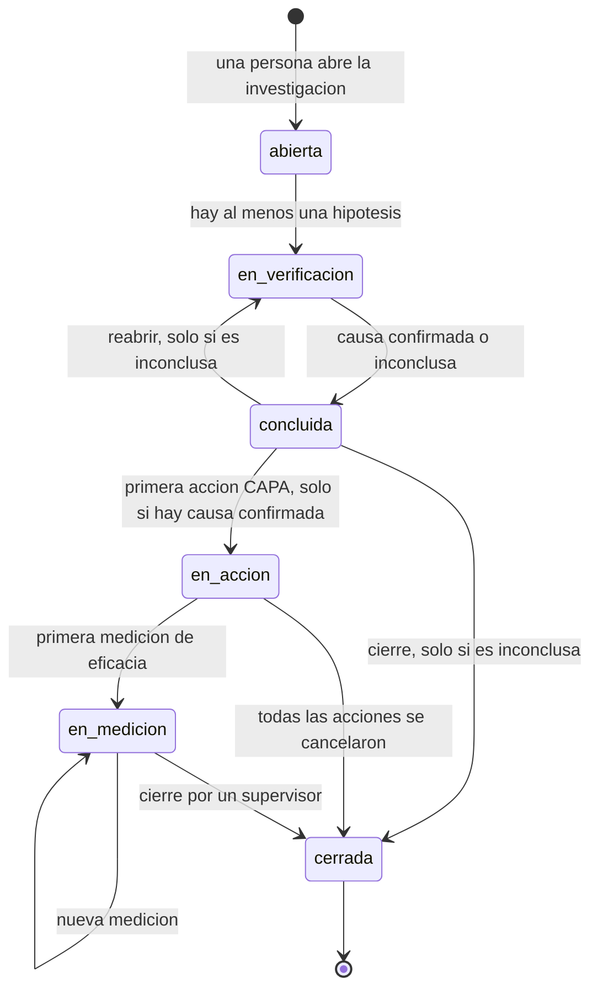
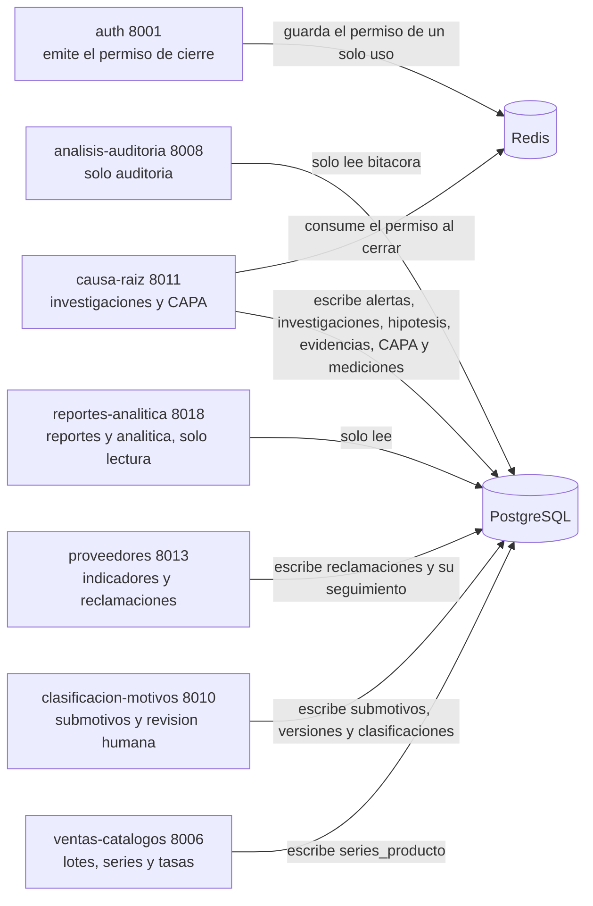

# Causa raiz: estados de una investigacion y servicios que intervienen

Dos diagramas del tercer parcial (calidad y causa raiz). Se verificaron contra
`services/causa_raiz/reglas.py` (`TRANSICIONES`), `services/causa_raiz/app.py`,
`docker-compose.yml` y las migraciones 040 a 045.

Trazabilidad: RF-22, RF-23, RF-24, RF-26, RF-28, RF-30, RN-09, RN-11, RN-12.

## 1. Estados de una investigacion

El analisis apoya y **cada paso lo decide una persona**: las alertas solo proponen
y ningun estado avanza solo. No se salta ningun paso (409 `transicion_invalida`).

Reglas que acompanan a las transiciones:

| Transicion | Regla |
|---|---|
| `abierta` a `en_verificacion` | Exige al menos una hipotesis (5 porques, Ishikawa o libre) |
| `en_verificacion` a `concluida` | Confirmar una causa exige evidencia y al menos una hipotesis verificada; una conclusion inconclusa no declara causa |
| `concluida` a `en_accion` | Solo con causa confirmada; el responsable de la accion debe ser personal interno activo |
| `en_accion` a `en_medicion` | La medicion compara la tasa de lo vendido antes y despues de implementar, sin contar lo que aun puede devolverse |
| a `cerrada` | Solo un Supervisor distinto del analista, reconfirmando su contrasena (operacion critica de `auth`) |

## 2. Servicios y datos

No hay llamadas HTTP entre estos servicios: se coordinan por la base y por Redis.
Cada tabla tiene un solo servicio que escribe en ella, salvo `bitacora`, donde
escriben todos y la base solo admite agregar (migracion 045).

