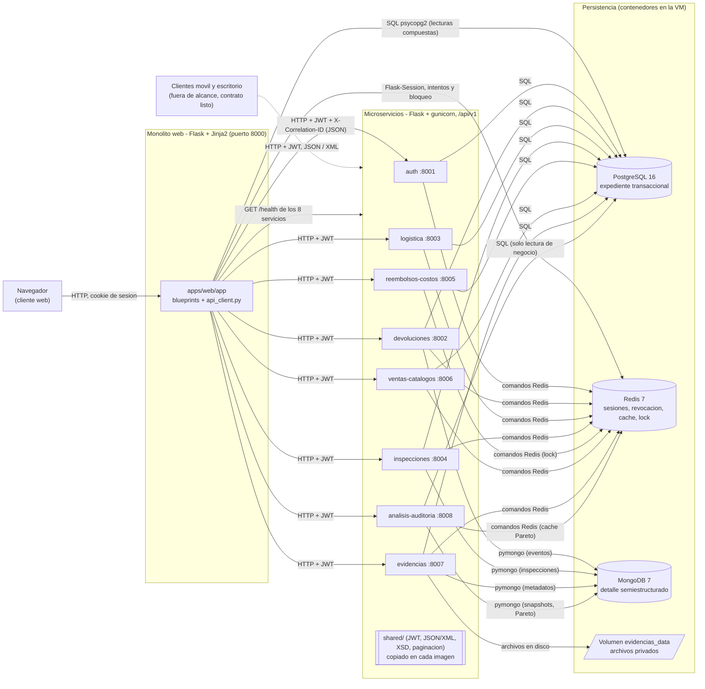

# Diagrama de componentes

Muestra las piezas del sistema y el protocolo de cada conexion. Se verifico
contra `docker-compose.yml`, `apps/web/app/config.py` (`SERVICE_URLS`),
`shared/infra.py`, `shared/mongo.py` y los `import` de cada `services/*/app.py`.

Trazabilidad: RNF-02, RNF-03, RNF-06, RNF-27, RF-31, RF-32.

## Lectura del diagrama

- Los **ocho** servicios consultan Redis en cada peticion protegida para
  verificar la sesion y la revocacion (`shared/seguridad.py:comprobar_en_redis`).
  Por eso todos tienen una flecha a Redis aunque solo `auth` escribe sesiones.
- Solo `devoluciones`, `inspecciones`, `evidencias` y `analisis-auditoria`
  hablan con MongoDB. `logistica`, `reembolsos-costos`, `ventas-catalogos` y
  `auth` no lo usan, y por eso sus contenedores no declaran `depends_on: mongo`.
- El web **no** se conecta a MongoDB.
- Las lecturas compuestas del expediente y de los paneles siguen yendo del web
  a PostgreSQL; las mutaciones del proceso pasan por el servicio responsable
  (`docs/INTEGRACION_WEB_MICROSERVICIOS.md`). Con `USE_MICROSERVICES=false` el
  web recupera su modo monolito.
- Los clientes movil y escritorio no forman parte de esta entrega (ver
  `CLAUDE.md`, "Alcance"); la linea punteada indica que el contrato JSON/XML ya
  esta implementado.
