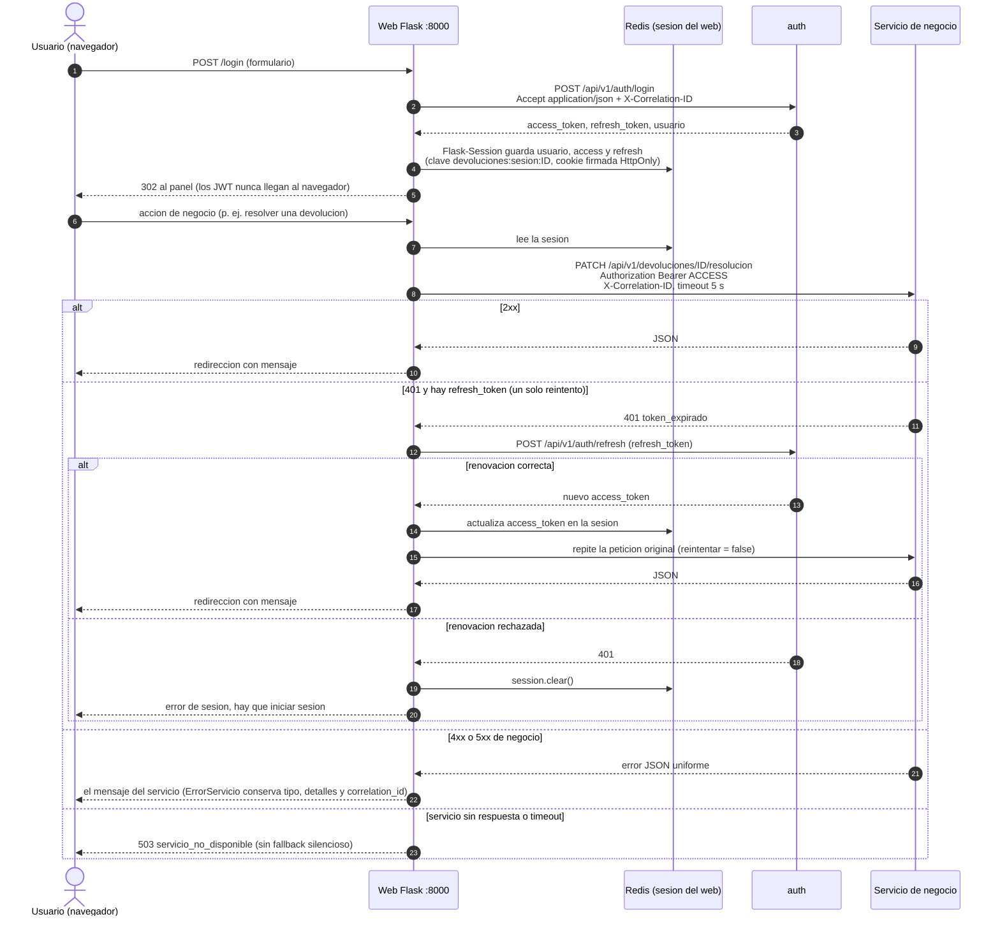
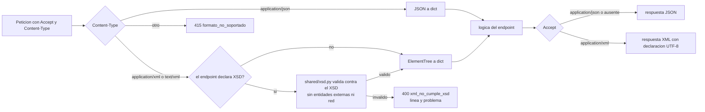

# Comunicacion del web con los microservicios

Describe como `apps/web/app/api_client.py` llama a las API. Verificado contra
ese modulo, `apps/web/app/config.py`, `apps/web/app/blueprints/auth.py`,
`apps/web/app/microservicios.py` y `apps/web/app/security.py`.

Trazabilidad: RF-31, RF-32, RNF-04, RNF-08, RNF-22, RNF-23.

## Encabezados y formato

| Aspecto | Lo que hace el codigo |
|---|---|
| Autenticacion | `Authorization: Bearer <access_token>` tomado de la sesion del servidor (`session["access_token"]`). |
| Correlacion | `X-Correlation-ID` con `security.correlation_id()`: un identificador de 16 caracteres por peticion web. El servicio lo respeta (`shared/respuestas.py`) y lo devuelve en la respuesta y en la bitacora. |
| Formato | El web envia y pide **JSON** (`Accept` y `Content-Type: application/json`). No negocia XML. |
| Renovacion | Un solo reintento tras un 401; si `refresh` falla se limpia la sesion. |
| Timeout | `MICROSERVICE_TIMEOUT` (5 s por defecto). Errores de red se convierten en `ErrorServicio` 503 `servicio_no_disponible`. |
| Direcciones | `SERVICE_URLS` de `config.py`, por ejemplo `http://auth:8000` (DNS interno de Compose). |
| Salud | `microservicios.estado_arquitectura()` consulta `GET /health` de los ocho servicios con timeout de 2 s para el panel `/integracion/servicios` (solo Administrador). |
| Contingencia | `USE_MICROSERVICES=false` devuelve las rutas a su logica de monolito. No hay fallback automatico. |

## Negociacion JSON / XML (lado servidor)

El XML existe para el cliente de escritorio, no para el web. El servidor decide
el formato de la respuesta con `Accept` (`shared/respuestas.py:quiere_xml`) y
acepta cuerpos `application/json` o `application/xml`.

> **EVIDENCIA PENDIENTE [EV-05]:** captura de la bitacora o de los logs de dos
> servicios con el mismo `correlation_id` originado en una accion del web.
> <!-- EVIDENCIA PENDIENTE: EV-05 correlation_id de punta a punta -->
