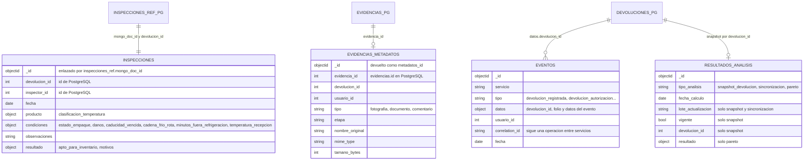

# Modelo de datos MongoDB

Base `devoluciones` (variable `MONGO_DB`), cuatro colecciones creadas por
`db/mongo/init.js` y usadas por cuatro servicios mediante `shared/mongo.py`.
La forma de los documentos se tomo de los `insert_one` y `bulk_write` de cada
`app.py`, no de un diseno previo.

Trazabilidad: RNF-06, RNF-23, RF-09, RF-16, RF-17, RF-23, RF-26, RN-09.

## Acceso y seguridad

- `init.js` crea un usuario de aplicacion con rol `readWrite` **solo** sobre su
  base (minimo privilegio, RNF-14). Los servicios nunca usan el administrador.
- `shared/mongo.py:get_mongo()` se conecta con `MONGO_APP_USER` y
  `authSource = MONGO_DB`, con `tz_aware=True` y 3 s de seleccion de servidor.
- `init.js` corre **una sola vez**, cuando el volumen `mongo_data` esta vacio.

## Colecciones y su relacion con PostgreSQL



Las entidades con sufijo `_PG` son las tablas de PostgreSQL
(`inspecciones_ref`, `evidencias`, `devoluciones`); estan aqui solo para mostrar
el enlace por identificador. No hay llaves foraneas entre motores.

## Detalle por coleccion

### `inspecciones` (servicio `inspecciones`, RF-16, RF-17)

Documento de detalle de la inspeccion, escrito en `POST /api/v1/inspecciones`.
Ejemplo de **forma** (los valores son ilustrativos, no una captura):

```json
{
  "devolucion_id": 33,
  "inspector_id": 5,
  "fecha": "ISODate",
  "producto": {"clasificacion_temperatura": "refrigerado"},
  "condiciones": {
    "estado_empaque": "texto",
    "danos": false,
    "caducidad_vencida": false,
    "cadena_frio_rota": false,
    "minutos_fuera_refrigeracion": 20,
    "temperatura_recepcion": 4
  },
  "observaciones": "texto",
  "resultado": {"apto_para_inventario": true, "motivos": []}
}
```

- **Indices**: `idx_devolucion` (`devolucion_id`, creado en `init.js`) y el
  servicio ejecuta `create_index("devolucion_id", unique=True,
  name="uq_inspeccion_devolucion")` en cada alta.
- **Operaciones**: `insert_one` (alta), `find_one` (consulta por
  `devolucion_id`), `update_one` con `$set` (corregir `estado_empaque` y
  `observaciones`).
- **Compensacion**: si el `INSERT` en `inspecciones_ref` falla, el servicio
  borra el documento recien insertado.
- El veredicto `apto_para_inventario` tambien se copia a PostgreSQL para que el
  trigger de la base pueda validar RN-06 y RN-07.

### `evidencias_metadatos` (servicio `evidencias`, RF-09)

Una fila por evidencia (archivo o comentario). Campos: `evidencia_id`,
`devolucion_id`, `usuario_id`, `tipo`, `etapa`, `nombre_original`, `mime_type`,
`tamano_bytes` (los tres ultimos son `null` en un comentario).

- **Indice**: `idx_devolucion` (`devolucion_id`).
- **Operaciones**: `insert_one` al crear; `find` por `evidencia_id` al consultar
  el detalle; `delete_one` si algo falla despues de insertar (compensacion).
- El archivo **no** esta en MongoDB: vive en el volumen `evidencias_data`.

### `eventos` (compartida, RNF-23)

Registrada por `shared/mongo.py:registrar_evento()`. Hoy **solo** el servicio
`devoluciones` publica eventos (`devolucion_registrada`,
`devolucion_corregida`, `devolucion_autorizacion`, `devolucion_rechazo`,
`devolucion_solicitud_informacion`, `devolucion_cancelada`). Un fallo al
escribir el evento se registra en el log y no deshace la operacion de negocio.

- **Indices**: `idx_correlation` (`correlation_id`), `idx_fecha` (`fecha`
  descendente) y `idx_devolucion_fecha` (`datos.devolucion_id`, `fecha`
  descendente), este ultimo creado por `devoluciones` al primer uso.
- **Operaciones**: `insert_one`; `find` filtrado por `datos.devolucion_id` con
  `sort` y `limit(50)` (expediente); `count_documents` y `find` con
  `skip/limit` y filtros `correlation_id` y `servicio`
  (`GET /api/v1/analisis/eventos`).

### `resultados_analisis` (servicio `analisis-auditoria`, RF-23, RF-26)

Tres tipos de documento, distinguidos por `tipo_analisis`:

| `tipo_analisis` | Campos | Quien lo escribe |
|---|---|---|
| `snapshot_devolucion` | `devolucion_id`, `folio_devolucion`, `estado`, `fecha_solicitud`, `cantidad_devuelta`, `motivo`, `producto`, `lote`, `proveedor`, `tienda`, `ruta`, `transportista`, `costo_total`, `vigente`, `lote_actualizacion`, `fecha_calculo` | `POST /analisis/sincronizar` (`bulk_write` con `UpdateOne` y `upsert`) |
| `sincronizacion` | `fecha_calculo`, `lote_actualizacion`, `casos`, `correlation_id` | `POST /analisis/sincronizar` |
| `pareto` | `dimension`, `medida`, `desde`, `hasta`, `fecha_calculo`, `usuario_id`, `correlation_id`, `resultado` | `GET /analisis/pareto` en un cache miss |

- **Indices**: `idx_tipo_fecha` (`tipo_analisis`, `fecha_calculo` descendente,
  de `init.js`) y `idx_snapshot_devolucion_unico` (`tipo_analisis`,
  `devolucion_id`; unico y parcial solo para `snapshot_devolucion`; lo crea el
  servicio al sincronizar).
- **Operaciones**: `bulk_write` con upsert; `update_many` que marca
  `vigente = false` a lo que desaparecio del lote; `insert_one`;
  `find_one`; `count_documents`; y la **agregacion** del Pareto
  (`$match` por `tipo_analisis`, `vigente` y rango de `fecha_solicitud`,
  `$group` por la dimension con `$sum`, `$sort`).
- **Principio**: PostgreSQL sigue siendo la fuente oficial; esta coleccion es
  una proyeccion derivada y su lectura es apoyo, no determinacion de causa
  (RN-09).

## Lo que la rubrica de MongoDB pide demostrar y donde ocurre

| Operacion | Donde en el codigo |
|---|---|
| Insercion | `inspecciones` (alta), `evidencias` (metadatos), `eventos`, `resultados_analisis` |
| Consulta | `find_one` en inspecciones, `find` en evidencias y eventos |
| Actualizacion | `update_one` en `inspecciones.actualizar`, `bulk_write` y `update_many` en `sincronizar` |
| Agregacion | `calcular_pareto` en `services/analisis_auditoria/app.py` |
| Indexacion | `init.js` y los `create_index` de los servicios |
| Filtrado | eventos por `correlation_id` y `servicio`; Pareto por fechas |
| Recuperacion por identificadores relacionados | `devolucion_id`, `evidencia_id`, `mongo_doc_id` |

## Punto a verificar en la VM

`init.js` crea `idx_devolucion` sobre `devolucion_id` en `inspecciones`, y el
servicio de inspecciones pide despues un indice **unico** sobre la misma llave
con otro nombre (`uq_inspeccion_devolucion`). MongoDB puede rechazar dos indices
con la misma llave y opciones distintas. El documento no afirma cual es el
comportamiento: debe comprobarse con `db.inspecciones.getIndexes()` en la VM y
documentarse el resultado.

> **EVIDENCIA PENDIENTE [EV-07]:** salida de `show collections`,
> `db.<coleccion>.getIndexes()` y un `findOne()` de cada coleccion en la VM
> (comando en `docs/SETUP.md`, seccion "Consola de MongoDB"), y de una
> agregacion de Pareto. <!-- EVIDENCIA PENDIENTE: EV-07 colecciones, indices y documentos en Mongo -->
