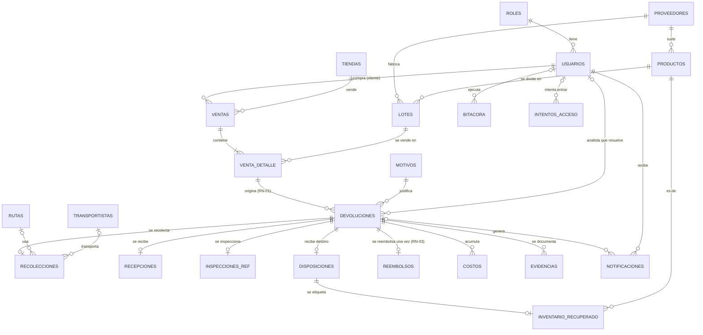
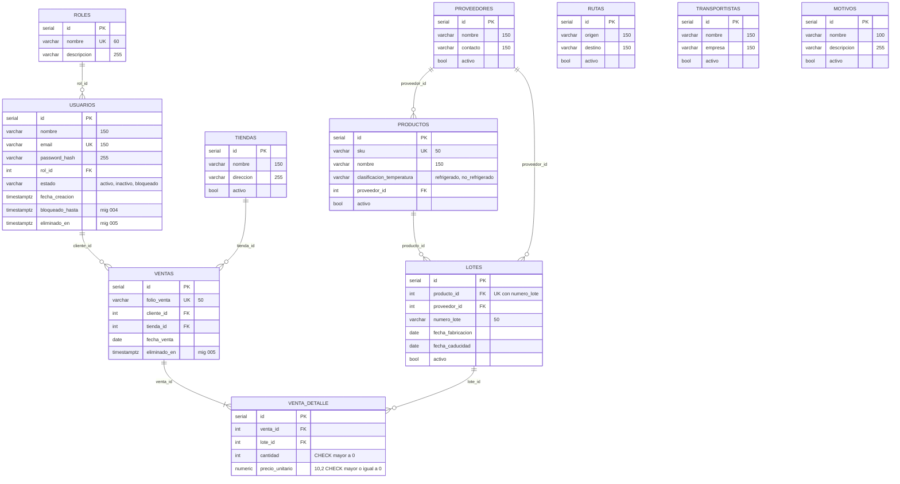

# Modelo de datos PostgreSQL (logico y fisico)

Reconstruido leyendo las migraciones `db/migrations/001` a `013` en orden, es
decir, el esquema **resultante** despues de aplicarlas todas (por ejemplo,
`ventas` ya no tiene `lote_id`, `cantidad` ni `precio` desde la 002, y
`devoluciones.venta_id` fue sustituido por `venta_detalle_id`). Ninguna
migracion se edito para este documento.

Trazabilidad: RNF-06, RNF-11, RNF-18, RNF-19, RNF-30, RN-01 a RN-07, RN-12.

## 1. Diagrama logico (entidades y relaciones)

Solo identificadores y atributos clave. Cada devolucion cuelga de **una linea
de venta** (RN-01) y de ella se obtiene el cliente, el lote y el producto (3FN:
`devoluciones` no guarda `cliente_id`).

Notas de cardinalidad:

- `recolecciones`, `recepciones`, `inspecciones_ref`, `disposiciones` y
  `reembolsos` tienen `devolucion_id UNIQUE`: como maximo **uno** por
  devolucion. `inventario_recuperado.disposicion_id` tambien es `UNIQUE`.
- `costos` y `evidencias` admiten varias filas por devolucion.
- `inspecciones_ref.mongo_doc_id` apunta al documento de la coleccion
  `inspecciones` de MongoDB (ver `datos_mongodb.md`); no es una llave foranea.
- La tabla de control `schema_migrations(version PK, checksum, aplicada_en)` la
  crea `scripts/migrate.py` y no forma parte del dominio.

## 2. Diagrama fisico (columnas, tipos y llaves)

Los tamanos de `VARCHAR` y `NUMERIC` se anotan entre comillas para no depender
de la sintaxis del renderizador. `PK` llave primaria, `FK` llave foranea, `UK`
unica. Todas las llaves foraneas son `ON DELETE RESTRICT` salvo las indicadas.

### 2.1 Catalogos, usuarios y ventas

### 2.2 Proceso de la devolucion

```mermaid
erDiagram
    DEVOLUCIONES {
        serial id PK
        varchar folio_devolucion UK "50, DEFAULT fn_nuevo_folio_devolucion()"
        int venta_detalle_id FK "mig 002, reemplaza venta_id"
        int motivo_id FK
        text descripcion_problema
        varchar estado "9 estados, CHECK"
        int analista_id FK "usuarios, nullable"
        int cantidad_devuelta "mig 002, CHECK mayor a 0"
        timestamptz fecha_solicitud
        timestamptz fecha_autorizacion
        timestamptz fecha_cierre "mig 012"
        timestamptz eliminado_en "mig 005"
    }
    RECOLECCIONES {
        serial id PK
        int devolucion_id FK, UK
        date fecha_programada
        varchar lugar "255"
        int ruta_id FK "nullable"
        int transportista_id FK "nullable"
        int coordinador_id FK "usuarios, nullable"
        varchar estado "programada, asignada, en_transito, completada, fallida"
    }
    RECEPCIONES {
        serial id PK
        int devolucion_id FK, UK
        int encargado_id FK "usuarios"
        timestamptz fecha_recepcion
        bool coincide_expediente
    }
    INSPECCIONES_REF {
        serial id PK
        int devolucion_id FK, UK
        int inspector_id FK "usuarios"
        timestamptz fecha_inspeccion
        varchar resultado_general "50"
        varchar mongo_doc_id "100, id del documento en MongoDB"
        bool apto_para_inventario "base de RN-06 y RN-07"
    }
    DISPOSICIONES {
        serial id PK
        int devolucion_id FK, UK
        int analista_id FK "usuarios"
        varchar destino "7 destinos, CHECK mig 011"
        text justificacion
        timestamptz fecha_decision
    }
    INVENTARIO_RECUPERADO {
        serial id PK
        int disposicion_id FK, UK
        int producto_id FK
        varchar etiqueta_codigo UK "50"
        timestamptz fecha_ingreso
        varchar estado "disponible, reservado, vendido"
    }
    REEMBOLSOS {
        serial id PK
        int devolucion_id FK, UK "garantiza RN-03"
        int encargado_id FK "usuarios"
        numeric monto "10,2 CHECK mayor o igual a 0"
        varchar metodo "transferencia, tarjeta, efectivo, vale"
        varchar estado "pendiente, aprobado, rechazado"
        timestamptz fecha_resolucion
        timestamptz eliminado_en "mig 005"
    }
    COSTOS {
        serial id PK
        int devolucion_id FK
        varchar etapa "7 etapas, CHECK mig 009"
        numeric monto "10,2"
        date fecha
    }
    EVIDENCIAS {
        serial id PK
        int devolucion_id FK
        int usuario_id FK
        varchar tipo "fotografia, documento, comentario"
        varchar etapa "solicitud, recoleccion, recepcion, inspeccion"
        text comentario
        varchar bucket "100"
        varchar objeto "255, nombre interno del archivo"
        varchar nombre_original "255"
        varchar mime_type "100"
        bigint tamano_bytes
        timestamptz fecha_registro
        timestamptz eliminado_en "mig 005"
    }
    NOTIFICACIONES {
        serial id PK
        int usuario_id FK "ON DELETE CASCADE"
        int devolucion_id FK "ON DELETE CASCADE, nullable"
        varchar tipo "50"
        varchar mensaje "500"
        varchar url "255, mig 013, enlace a la pantalla de accion"
        bool leido
        timestamptz fecha_creacion
    }
    BITACORA {
        serial id PK
        int usuario_id FK "ON DELETE SET NULL"
        varchar accion "100"
        varchar entidad "60"
        int entidad_id
        text detalle
        varchar correlation_id "100"
        timestamptz fecha
        varchar ip_origen "45, mig 004"
    }
    INTENTOS_ACCESO {
        serial id PK
        varchar email "150"
        int usuario_id FK "ON DELETE SET NULL"
        bool exitoso
        varchar ip_origen "45"
        varchar user_agent "255"
        timestamptz fecha
    }
    DEVOLUCIONES ||--o| RECOLECCIONES : devolucion_id
    DEVOLUCIONES ||--o| RECEPCIONES : devolucion_id
    DEVOLUCIONES ||--o| INSPECCIONES_REF : devolucion_id
    DEVOLUCIONES ||--o| DISPOSICIONES : devolucion_id
    DISPOSICIONES ||--o| INVENTARIO_RECUPERADO : disposicion_id
    DEVOLUCIONES ||--o| REEMBOLSOS : devolucion_id
    DEVOLUCIONES ||--o{ COSTOS : devolucion_id
    DEVOLUCIONES ||--o{ EVIDENCIAS : devolucion_id
    DEVOLUCIONES |o--o{ NOTIFICACIONES : devolucion_id
```

Las llaves foraneas de `devoluciones` hacia `venta_detalle`, `motivos` y
`usuarios`, de `recolecciones` hacia `rutas` y `transportistas`, y las de
usuario de `bitacora` e `intentos_acceso` se muestran en el diagrama logico
para no cruzar los dos bloques fisicos.

## 3. Restricciones, triggers, secuencia y vista

| Objeto | Migracion | Que garantiza | Reglas |
|---|---|---|---|
| `UNIQUE` en `folio_devolucion` y `seq_folio_devolucion` + `fn_nuevo_folio_devolucion()` (`DEFAULT` del folio, formato `DEV-AAAA-NNNN`) | 001, 007 | Folio unico, sin colisiones con usuarios concurrentes | RN-02, RF-08, RNF-19 |
| `UNIQUE (devolucion_id)` en `reembolsos` | 001 | Un solo reembolso por devolucion | RN-03, RF-21 |
| `devoluciones.venta_detalle_id NOT NULL` | 002 | Toda devolucion nace de una linea de venta | RN-01, RF-06 |
| `CHECK` de `estado`, `destino`, `etapa`, `metodo`, `clasificacion_temperatura` | 001, 009, 011 | Dominios cerrados, sin valores inventados | RN-05, RF-18, RF-27 |
| Trigger `trg_validar_destino_inventario` (BEFORE INSERT/UPDATE en `disposiciones`) y `fn_validar_destino_inventario()` | 001 | Impide destino `inventario` sin inspeccion o con `apto_para_inventario = FALSE` | RN-06, RN-07 |
| Trigger `trg_validar_reembolso` (BEFORE INSERT/UPDATE en `reembolsos`) y `fn_validar_reembolso()` | 006 | Impide aprobar sobre una devolucion `solicitada`, `en_revision` o `rechazada`, y un monto mayor al valor devuelto | RN-04, RF-20, RF-25 |
| Trigger `trg_validar_inspeccion_vs_disposicion` (BEFORE UPDATE en `inspecciones_ref`) | 006 | Impide marcar "no apto" una inspeccion cuya disposicion ya es `inventario` | RN-06, RN-07 |
| Columnas `eliminado_en` (usuarios, ventas, devoluciones, evidencias, reembolsos) e indices parciales `idx_devoluciones_vigentes`, `idx_usuarios_vigentes` | 005 | Eliminacion logica y retencion | RNF-30, RN-12 |
| Vista `vista_costo_devolucion` | 010 | Total y desglose de costos por devolucion, sin duplicar datos | RF-26, RF-27 |
| Indices en llaves foraneas y `idx_devoluciones_estado`, `idx_devoluciones_fecha_solicitud`, `idx_intentos_email` | 001, 002, 004, 012 | Consultas frecuentes bajo tres segundos | RNF-18 |

Nota sobre la ubicacion de los triggers: `trg_validar_destino_inventario`
nace en la migracion **001**; la **006** agrega `trg_validar_reembolso` y
`trg_validar_inspeccion_vs_disposicion`.

Vista `vista_costo_devolucion`: columnas `devolucion_id`, `costo_transporte`,
`costo_inspeccion`, `costo_almacenamiento`, `costo_reacondicionamiento`,
`costo_destruccion`, `monto_reembolsado`, `costo_otros` y `costo_total`.

> **EVIDENCIA PENDIENTE [EV-06]:** en la VM, la salida de
> `docker compose exec app python scripts/migrate.py --estado` con las 13
> migraciones aplicadas y, con `docker compose exec postgres psql -U
> devoluciones_app -d devoluciones`, la de `\dt`, `\d devoluciones`, `\df fn_*`
> y la lista de triggers. <!-- EVIDENCIA PENDIENTE: EV-06 esquema real en la VM -->
