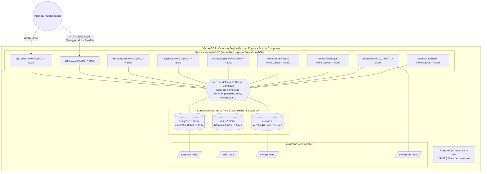

# Diagrama de despliegue

Nodo fisico: la maquina virtual de Google Compute Engine del equipo (CentOS
Stream 10 con SELinux en `Enforcing`, segun `docs/BITACORA.md`). Todo corre en
contenedores de un unico `docker-compose.yml`. Los puertos y la direccion de
enlace salen literalmente del compose.

Trazabilidad: RNF-02, RNF-03, RNF-22, RNF-27.

## Puertos

| Contenedor | Puerto host | Enlace | Puerto interno | Comentario |
|---|---:|---|---:|---|
| app (web) | `${APP_PORT:-8000}` | `0.0.0.0` | 8000 | monta `./:/srv/app:z` (SELinux) |
| auth | 8001 | `0.0.0.0` | 8000 | con `healthcheck` |
| devoluciones | 8002 | `0.0.0.0` | 8000 | con `healthcheck` |
| logistica | 8003 | `0.0.0.0` | 8000 | sin `healthcheck` en el compose |
| inspecciones | 8004 | `0.0.0.0` | 8000 | sin `healthcheck` en el compose |
| reembolsos-costos | 8005 | `0.0.0.0` | 8000 | sin `healthcheck` en el compose |
| ventas-catalogos | 8006 | `0.0.0.0` | 8000 | con `healthcheck` |
| evidencias | 8007 | `0.0.0.0` | 8000 | con `healthcheck`; volumen `evidencias_data` en `/srv/evidencias_privadas` |
| analisis-auditoria | 8008 | `0.0.0.0` | 8000 | con `healthcheck` |
| postgres | 55432 | `127.0.0.1` | 5432 | el 5432 de la VM lo ocupa un PostgreSQL nativo ajeno |
| redis | 56379 | `127.0.0.1` | 6379 | `--appendonly yes` |
| mongo | 57017 | `127.0.0.1` | 27017 | `init.js` solo corre con el volumen vacio |

Los contenedores se hablan por la red interna de Compose usando el nombre del
servicio y el puerto **interno** (por ejemplo `http://auth:8000`,
`postgres:5432`); los puertos `55432/56379/57017` solo sirven para clientes
ejecutados dentro de la VM.

Los servicios sin `healthcheck` en el compose (logistica, inspecciones,
reembolsos-costos) igualmente exponen `GET /health`; el panel web
`/integracion/servicios` consulta los ocho.

## Volumenes

| Volumen | Montado en | Contenido |
|---|---|---|
| `postgres_data` | `/var/lib/postgresql/data` (postgres) | datos de PostgreSQL |
| `redis_data` | `/data` (redis) | AOF de Redis |
| `mongo_data` | `/data/db` (mongo) | datos de MongoDB |
| `evidencias_data` | `/srv/evidencias_privadas` (evidencias) | archivos JPG/PNG/PDF con nombre aleatorio |

> **EVIDENCIA PENDIENTE [EV-01]:** captura de `docker compose ps` en la VM con
> los 12 contenedores y sus puertos. <!-- EVIDENCIA PENDIENTE: EV-01 docker compose ps -->

> **EVIDENCIA PENDIENTE [EV-02]:** captura de las reglas de firewall de GCP y
> de la VM en la consola de Compute Engine.
> <!-- EVIDENCIA PENDIENTE: EV-02 firewall y VM en consola GCP -->
