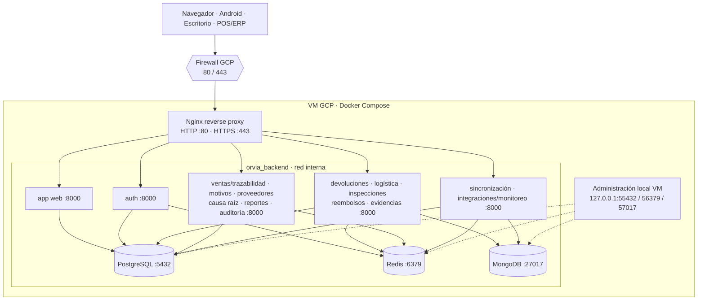

# Diagrama de despliegue

Nodo físico: VM de Google Compute Engine con Docker Compose. Nginx es el único
punto de entrada; las aplicaciones y microservicios sólo exponen el puerto 8000
a la red interna `orvia_backend`.

Trazabilidad: RNF-02, RNF-03, RNF-13, RNF-14, RNF-22, RNF-27.

## Puertos publicados

| Contenedor | Host | Contenedor | Alcance |
|---|---:|---:|---|
| proxy | `${PROXY_HTTP_PORT:-80}` | 8080 | público; redirige a TLS en la variante HTTPS |
| proxy (TLS) | `${PROXY_HTTPS_PORT:-443}` | 8443 | público; certificado externo al repositorio |
| postgres | 127.0.0.1:55432 | 5432 | administración local de la VM |
| redis | 127.0.0.1:56379 | 6379 | administración local de la VM |
| mongo | 127.0.0.1:57017 | 27017 | administración local de la VM |

Web y microservicios usan `expose: 8000`, no `ports`; Docker DNS resuelve sus
nombres únicamente dentro de `orvia_backend`. Nginx pertenece además a
`orvia_public`, por lo que es el único puente entre Internet y el backend.

## Enrutamiento

- `/` → aplicación web.
- `/api/v1/<dominio>` → microservicio propietario del contrato.
- `/servicios/<nombre>/docs` → Swagger del servicio.
- `/servicios/<nombre>/health` → health check del servicio.
- `/proxy-health` → salud de Nginx sin dependencia del backend.

La matriz completa está en `docs/REVERSE_PROXY.md` y la configuración ejecutable
en `infra/nginx/`.

## Volúmenes

| Volumen | Montado en | Contenido |
|---|---|---|
| `postgres_data` | `/var/lib/postgresql/data` | datos transaccionales |
| `redis_data` | `/data` | sesiones, revocación, caché y bloqueos |
| `mongo_data` | `/data/db` | documentos y eventos |
| `evidencias_data` | `/srv/evidencias_privadas` | archivos privados |

La evidencia debe mostrar que sólo proxy publica 80/443 y que las API responden
por `/servicios/`, no mediante 8001–8021.
