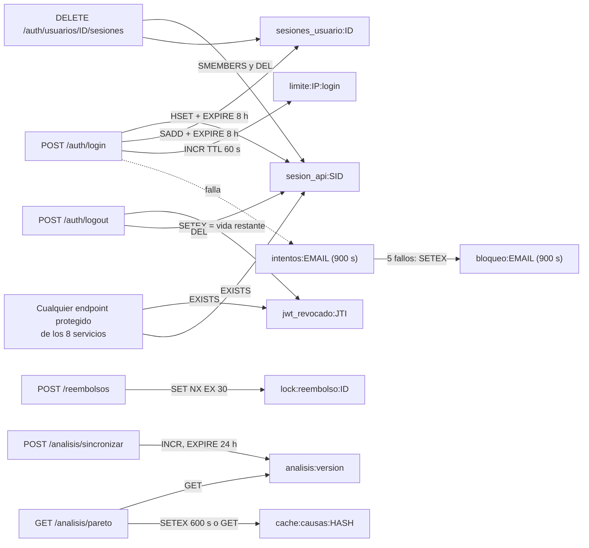

# Diseno de claves de Redis

Inventario de **todas** las claves que el codigo escribe o lee. Se obtuvo
buscando `PREFIJO`, `get_redis()` y los literales `devoluciones:` en `shared/`,
`services/*/app.py` y `apps/web/app/`. El prefijo comun es `PREFIJO =
"devoluciones:"` (`shared/infra.py`). Redis 7 corre con `--appendonly yes`
(AOF) sobre el volumen `redis_data`.

Trazabilidad: RNF-06, RNF-08, RNF-12, RNF-13, RNF-21, RN-03, RF-26.

## Tabla de claves

| Patron | Tipo | Finalidad | TTL | Escribe | Lee |
|---|---|---|---|---|---|
| `devoluciones:sesion:<id>` | string (Flask-Session) | Sesion server-side del **web**: usuario, `access_token` y `refresh_token` | lo fija Flask-Session (no se configura en el proyecto; `SESSION_PERMANENT = False`) | `apps/web/app/__init__.py` (`Session(app)`), `config.py` | el propio web |
| `devoluciones:sesion_api:<sid>` | hash: `usuario_id`, `rol`, `ip`, `creada` | Sesion de API. Mientras exista, los access tokens de ese `sid` se aceptan | `JWT_HORAS_REFRESH` x 3600 = 28 800 s (8 h) | `services/auth/app.py:_abrir_sesion` | los 8 servicios (`shared/seguridad.py:comprobar_en_redis`, `EXISTS`); `auth` en `GET /sesion` (`TTL`) |
| `devoluciones:sesiones_usuario:<usuario_id>` | set de `sid` | Indice de sesiones de un usuario para cerrarlas todas | 8 h, se renueva en cada login | `auth` (`_abrir_sesion`, `logout`) | `auth` en `DELETE /usuarios/<id>/sesiones` (`SMEMBERS`) |
| `devoluciones:jwt_revocado:<jti>` | string `"1"` | Lista negra de tokens revocados | tiempo restante de vida del token | `auth` (`logout` via `_revocar`) | los 8 servicios (`EXISTS`) |
| `devoluciones:intentos:<email>` | contador | Intentos fallidos de acceso | `MINUTOS_BLOQUEO` x 60 = 900 s, desde el primer fallo | `auth` (`_intento_fallido`) y web (`cache.registrar_intento_fallido`) | los mismos, y se borra tras un login correcto |
| `devoluciones:bloqueo:<email>` | string (fecha ISO del fin) | Bloqueo temporal tras `MAX_INTENTOS_FALLIDOS` (5) | 900 s | `auth` y web | `auth` y web (`TTL > 0`) |
| `devoluciones:limite:<sujeto>:<recurso>` | contador | Rate limiting por ventana fija | la ventana (60 s) | `shared/infra.py:limitar` | `limitar` (`INCR`, `TTL`) |
| `devoluciones:lock:reembolso:<devolucion_id>` | string (uuid) | Candado: una sola resolucion de reembolso a la vez por devolucion | 30 s; se libera antes con compare-and-delete (Lua) | `services/reembolsos_costos/app.py` (`SET NX EX 30`) | el mismo `SET NX` |
| `devoluciones:analisis:version` | contador entero | Version de los datos del analisis; invalida el cache al cambiar | 86 400 s, se renueva en cada sincronizacion | `services/analisis_auditoria/app.py:sincronizar` (`INCR`) | `pareto` (`GET`) |
| `devoluciones:cache:causas:<hash>` | string JSON | Cache del Pareto. El hash (24 caracteres de SHA-256) cubre version de datos, dimension, medida, `desde` y `hasta` | `TTL = 600` s (10 min) | `pareto` en un cache miss (`SETEX`) | `pareto` (`GET`, responde `cache: "hit"`) |

Valores de `<sujeto>:<recurso>` en `limitar` (verificados con `grep limitar(`):

| Recurso | Maximo | Ventana | Sujeto | Lugar |
|---|---:|---:|---|---|
| `login` | `LOGIN_MAX_POR_MINUTO` (10) | 60 s | IP de origen | `auth /login` |
| `refresh` | 30 | 60 s | IP de origen | `auth /refresh` |
| `crear_devolucion` | `DEVOLUCIONES_MAX_POR_MINUTO` (20) | 60 s | `usuario<id>` | `devoluciones POST` |

Al exceder el limite se responde `429 demasiadas_peticiones` con el header
`Retry-After`. La IP sale de `request.remote_addr`; **no** se lee
`X-Forwarded-For` porque el cliente podria falsificarlo.

## Usos que pide el enunciado y donde se cubren

| Uso de Redis | Cubierto | Donde |
|---|---|---|
| Sesiones | si | `sesion_api`, `sesiones_usuario`, `sesion` (web) |
| Tokens revocados | si | `jwt_revocado` |
| Cache | si | `cache:causas`, con version `analisis:version` |
| Contadores | si | `intentos`, `limite`, `analisis:version` |
| Limites de consumo | si | `limite` en `auth` y `devoluciones` |
| Datos temporales | si | `bloqueo`, `lock:reembolso` |
| Bloqueos (locks) | si | `lock:reembolso` |
| Consulta en autenticacion/autorizacion por todos los componentes | si | `comprobar_en_redis` en los 8 servicios |

## Comportamiento cuando Redis no responde

| Situacion | Respuesta del codigo |
|---|---|
| Endpoint protegido de cualquier servicio | `503 seguridad_no_disponible` (falla cerrada: sin Redis no se sabe si el token sigue vigente) |
| `GET /health` | `redis.ok = false` y estado `degradado` con 503 |
| Rate limit (`limitar`) | no tiene manejo propio: la excepcion cae en el manejador general y responde `500 error_interno` |
| Bloqueo de cuenta | PostgreSQL conserva `usuarios.bloqueado_hasta`, asi que un reinicio de Redis no levanta los bloqueos (RNF-21) |

## Diagrama del ciclo de vida de las claves



## Comandos para comprobarlo en la VM

Usan el contenedor `redis` (no hay Redis local, ver `CLAUDE.md`). Dentro de la
VM, desde la raiz del repositorio:

```bash
docker compose exec redis redis-cli --scan --pattern 'devoluciones:*'
```

```bash
docker compose exec redis redis-cli --scan --pattern 'devoluciones:sesion_api:*'
```

```bash
docker compose exec redis redis-cli --scan --pattern 'devoluciones:jwt_revocado:*'
```

> **EVIDENCIA PENDIENTE [EV-08]:** capturas de `redis-cli` con `TTL` y `TYPE`
> de cada familia de claves: `sesion_api`, `jwt_revocado`, `limite` (con un 429
> real), `lock:reembolso` (durante la operacion), `analisis:version` y
> `cache:causas` (un `miss` y un `hit`).
> <!-- EVIDENCIA PENDIENTE: EV-08 claves Redis con TTL -->
