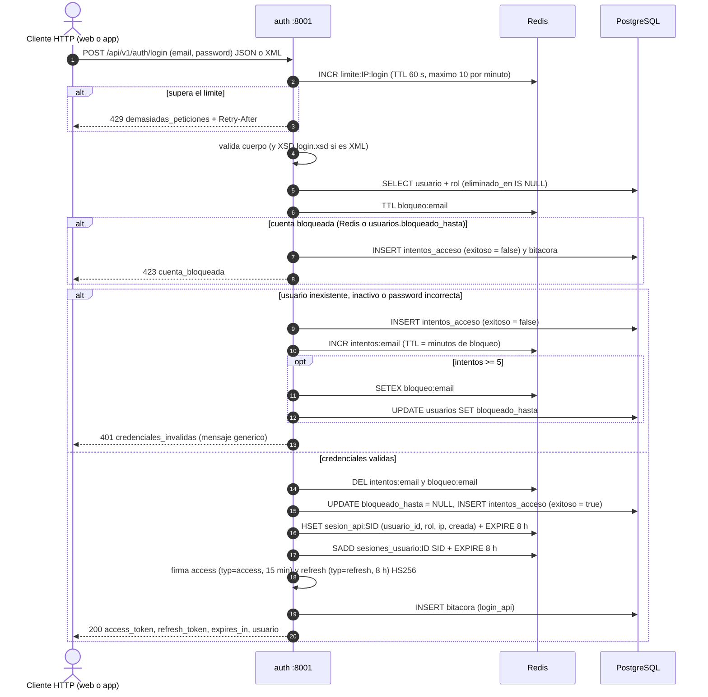
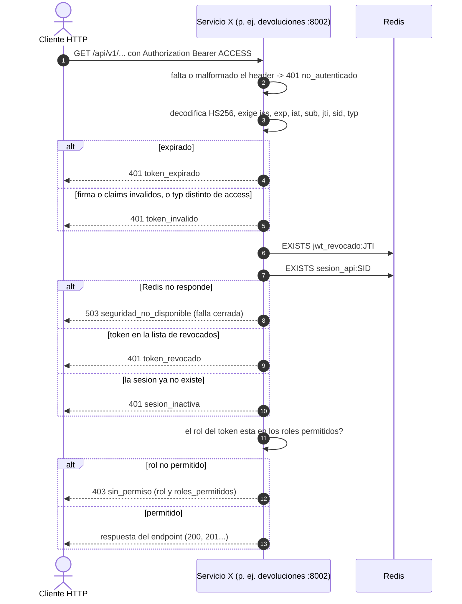
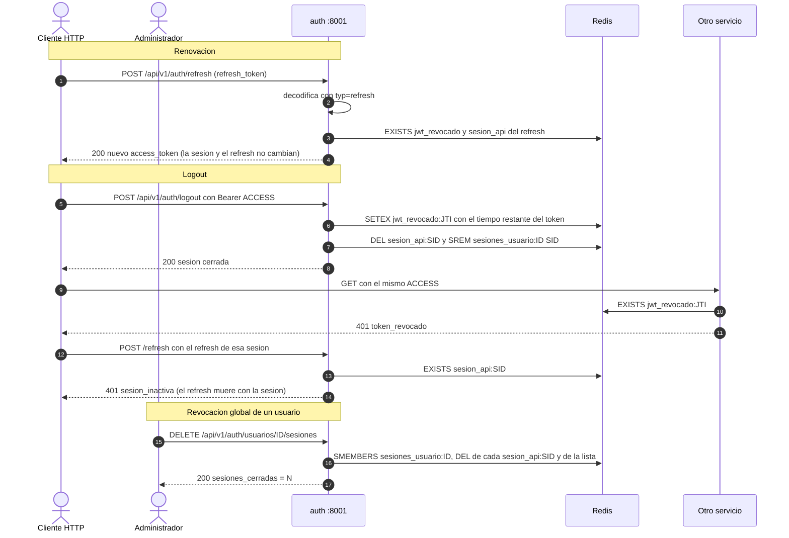

# Secuencia: login, JWT, verificacion entre servicios y revocacion

Verificado contra `services/auth/app.py` y `shared/seguridad.py`. Las claves
Redis llevan el prefijo `devoluciones:` (ver `redis_claves.md`).

Trazabilidad: RF-01, RNF-07, RNF-08, RNF-09, RNF-12, RNF-13, RNF-16, RNF-21.

## 1. Login y emision de tokens

Los claims de ambos tokens son `iss`, `sub`, `rol`, `nombre`, `sid`, `jti`,
`typ`, `iat` y `exp`. El `sid` enlaza el token con su sesion en Redis; el `jti`
identifica al token individual para poder revocarlo.

## 2. Verificacion en cualquier otro servicio

Es el decorador `requiere_jwt(*roles)`; lo ejecutan los ocho servicios en cada
endpoint protegido.

## 3. Renovacion, logout y revocacion

Notas verificadas en el codigo:

- El logout solo agrega a la lista negra el `jti` del **access** token que se
  presento; el refresh queda inutil porque se borra la sesion `sesion_api:<sid>`
  que `refresh` exige.
- La revocacion global usa `SMEMBERS` sobre `sesiones_usuario:<id>`; los
  access tokens ya emitidos dejan de servir sin esperar su vencimiento porque
  su `sid` ya no tiene sesion.
- Los tiempos salen de `JWT_MINUTOS_ACCESO` (15) y `JWT_HORAS_REFRESH` (8);
  el limite de login de `LOGIN_MAX_POR_MINUTO` (10) y `refresh` tiene un
  limite fijo de 30 por minuto.

> **EVIDENCIA PENDIENTE [EV-03]:** captura del login real con su respuesta y de
> `redis-cli` mostrando `sesion_api:*` con TTL y, tras el logout, el
> `jwt_revocado:*` correspondiente.
> <!-- EVIDENCIA PENDIENTE: EV-03 login, sesion y blacklist en Redis -->
