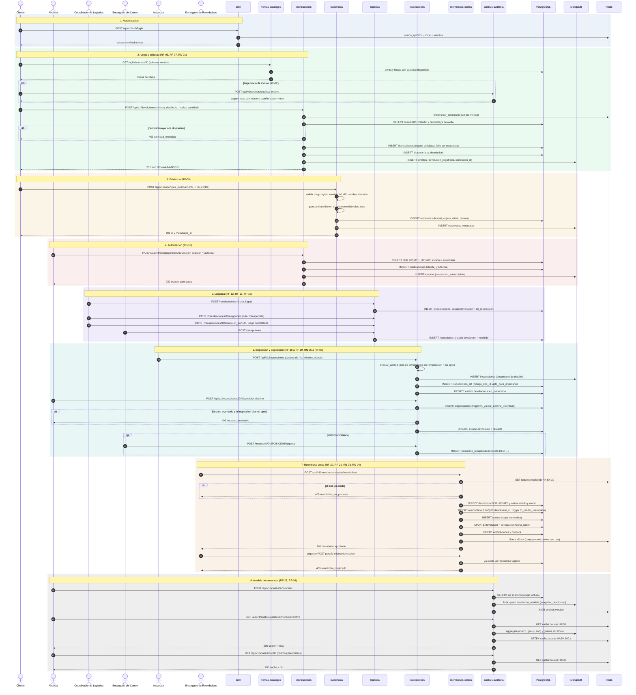

# Secuencia: proceso completo de una devolucion

Recorre una devolucion de un producto refrigerado desde el login hasta el
Pareto, con las transiciones de estado que realmente aplica el codigo. Verificado
contra los `app.py` de los ocho servicios y las migraciones 001 a 013.

Estados de `devoluciones.estado` (CHECK de la migracion 001):
`solicitada` -> `en_revision` / `autorizada` / `rechazada` -> `en_recoleccion`
-> `recibida` -> `en_inspeccion` -> `resuelta` -> `cerrada`.

Todas las llamadas llevan `Authorization: Bearer` y cada servicio verifica el
JWT y consulta Redis antes de ejecutar (ver `secuencia_login_jwt.md`); aqui no
se repite para no saturar el diagrama.

Trazabilidad: RF-01, RF-06 a RF-13, RF-15 a RF-23, RF-26, RF-27, RN-01 a RN-07,
RNF-19, RNF-23.

## Lo que el diagrama no inventa

- El **segundo intento de reembolso** devuelve `409 reembolso_duplicado`. Si
  dos solicitudes llegan a la vez, la segunda recibe `409 reembolso_en_proceso`
  por el lock de Redis; si el lock ya se libero, la protege el `UNIQUE
  (devolucion_id)` y la verificacion previa.
- El estado `cerrada` solo se aplica si la devolucion estaba `resuelta`
  (`services/reembolsos_costos/app.py`). Un rechazo del reembolso tambien
  queda registrado como fila en `reembolsos` con monto 0.
- Solo `devoluciones` publica eventos en la coleccion `eventos`; los otros
  servicios dejan huella en `bitacora` (PostgreSQL) con el mismo
  `correlation_id`.
- El hash de `cache:causas:HASH` incluye la version de datos, dimension, medida
  y rango de fechas; una nueva sincronizacion invalida el cache sin borrarlo.

> **EVIDENCIA PENDIENTE [EV-04]:** ejecucion real de este flujo en la VM
> (Postman o web) con capturas de cada paso, filas de PostgreSQL, documentos
> de MongoDB y claves de Redis. Existe un antecedente narrado en
> `docs/INTEGRACION_WEB_MICROSERVICIOS.md` (caso `DEV-2026-0033`), pero sin
> capturas en el repositorio.
> <!-- EVIDENCIA PENDIENTE: EV-04 flujo E2E con capturas -->
